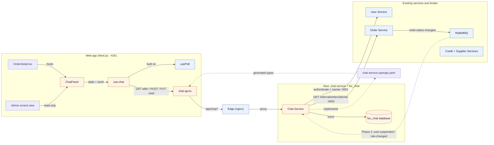

# Participant chat service design

This diagram converts the **FoC Chat Service Design** Enso canvas into a portable view of the proposed chat architecture in [ADR 0012](adr/0012-participant-chat.md).

Solid arrows show runtime calls or ownership. Dashed arrows show contract dependencies and the later WebSocket event path. The Credit and Supplier Services are intentionally unconnected: chat does not call them. The Order Service already emits `order.status-changed` to RabbitMQ; chat uses a live Order lookup for access decisions rather than consuming that event.

## Key relationships

- **Web app → chat:** `OrderDetail.tsx` hosts `ChatPanel`. The admin errand view can read the same conversation but cannot send or mark it read. `use-chat` polls through `usePoll` and calls `chat-api.ts` for message reads, sends, and read positions.
- **Edge → Chat Service:** `/api/chat/*` routes to the new service. Its API is defined in [`chat-service.openapi.yaml`](../contracts/chat-service.openapi.yaml); the web client uses generated types from that contract.
- **Chat Service → existing services:** Each request checks the current errand participants and status through `GET /internal/orders/{id}/chat`, and uses the User Service for caller identity and display names. Chat owns its messages, channels, and read positions in `foc_chat`.
- **Later WebSocket:** RabbitMQ's `user.suspended` and `role-changed` notifications support connection revocation in Phase 2. Message delivery remains through `GET /messages`; the socket only notifies the browser to fetch.

## Implementation notes from the canvas

- **Fifth-service wiring:** Add the chat service and database to Compose variants, environment setup, CI change detection, edge readiness, Prometheus, backup, and recovery.
- **Order internal authentication:** The Order Service needs an inbound `/internal` route and service-key guard for chat's lookup. Its internal port `4003` already exists.
- **Ports:** Host port `3005` is used by Grafana. Chat uses `3006` for its public port and `4005` for its internal port, preserving the Compose internal-port sequence.
- **Edge upgrade:** Polling works through the existing edge pattern. The later WebSocket requires an upgrade path for `/api/chat/`.
- **Decision record:** See [ADR 0012](adr/0012-participant-chat.md) for access, polling, message limits, retention, and unresolved implementation details.
