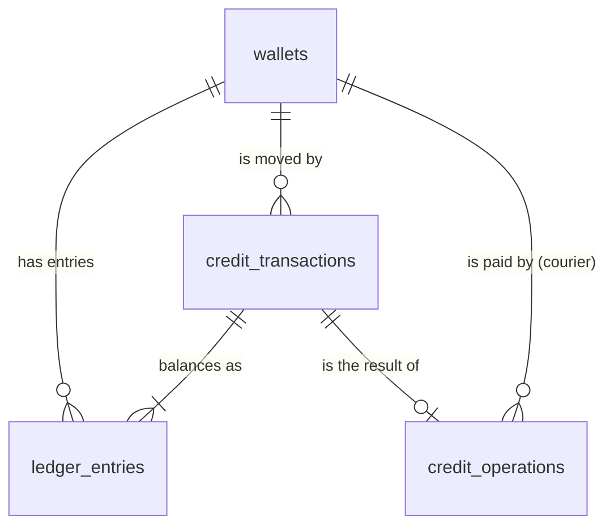

# Credit Service — Database Choice and Schema

D3 Part 2.1. Ticket: CRD-09 (#234). Backlog refs: CS-FR1.1.1, CS-NFR1.1.2, CS-NFR2.1.1.
The model these tables carry is decided in
[ADR 0007](../adr/0007-credit-invariant-and-double-entry-ledger.md); why Credit has a database of
its own is [ADR 0003](../adr/0003-service-boundaries-and-data-ownership.md). The service's behaviour
is in [`credit-service/README.md`](../../credit-service/README.md) and its API in
[`contracts/credit-service.openapi.yaml`](../../contracts/credit-service.openapi.yaml).

## 1. Database: PostgreSQL

**Why a relational database, and why PostgreSQL, for credits specifically**

- **Every movement is several rows that must land together.** A reservation changes the wallet,
  writes one transaction and two ledger entries, records the order's outcome, marks the request as
  received (inbox) and queues the reply (outbox). If the balance changed without its ledger
  entries, or the reply were sent for a movement that rolled back, the economy would no longer
  explain itself. One ACID transaction commits all of them or none, and the outbox and inbox
  (ADR 0009) depend on exactly that.
- **Concurrent updates are decided by the database, in one statement.** Two errands posted at once
  by the same student must not both spend the same credits. The debit is a single conditional
  `UPDATE wallets … WHERE available >= $amount`, so of two racing reservations the second sees the
  first's result and is refused if the money is gone. A transfer and a release for the same errand
  lock its reservation row (`SELECT … FOR UPDATE`) and then both wallets in `user_id` order, so they
  run one after the other and cannot deadlock. This works at PostgreSQL's default isolation level,
  `READ COMMITTED`, because no decision is a read followed by a separate write; the race tests run
  it on real PostgreSQL (`credit-service/test/reservations.postgres.test.ts`,
  `system-tests/test/races.test.ts`).
- **The rules are constraints, not just code.** `integer` columns hold whole credits only.
  `CHECK` constraints keep both balances non-negative and every amount positive. Partial unique
  indexes let a wallet be issued once, an order reserved once and settled once, whatever the code
  does. Triggers make the transactions, ledger entries and audit records append-only. A bug in a
  later code path, or a duplicate message arriving twice at the same moment, cannot write an
  impossible economy: the database refuses the row.
- **The questions asked of credits are relational ones.** A balance is a row read by primary key. A
  history is ledger entries joined to their transaction, by wallet, newest first, on an index. "Is
  the economy conserved?" and "does every transaction balance?" are `sum` and `GROUP BY` queries,
  which is how the tests, the failure demo and the walkthrough check them on a live database.
  Credit's status for an errand is a primary-key lookup on `credit_operations`.
- **Scale is one campus.** Around 10⁴ wallets and a handful of writes per errand. A single primary
  serves that with room to spare; nothing needs sharding, a cache or eventual consistency, which
  would be the wrong trade for a balance anyway.
- **One engine for the team.** Every FoC service runs on PostgreSQL, each with its own database and
  login (ADR 0003), so there is one Compose service and one skill set, and no service can read
  another's tables.

**Considered and rejected:**

- **A document store (MongoDB).** It has multi-document transactions, but the guarantees here are
  cross-row: one issue per wallet, one terminal outcome per order, an entry that must reference its
  transaction. Those are a unique index and a foreign key in PostgreSQL; in a document store they
  become application logic, which is what races.
- **A key-value store (Redis).** Atomic counters would make the debit easy, but it is not a durable
  system of record, has no constraints or joins, and cannot hold an immutable ledger that explains
  each balance.
- **A purpose-built ledger database (for example TigerBeetle).** Its double-entry accounts and
  two-phase transfers map well onto available, reserved and transfer. It would add a second engine
  to run, back up and learn, for a load PostgreSQL handles easily, and the order-keyed idempotency,
  audit and inbox/outbox tables would still need PostgreSQL beside it.

## 2. Schema

Forward-only migrations in `credit-service/drizzle/`, generated from
`credit-service/src/db/schema.ts` (custom ones are noted). Identifiers from other services
(`user_id`, `order_id`) are `text`, because Credit does not own them and has no foreign key into
another service's database. Its own ids are UUIDs, and every timestamp is `timestamptz` (UTC).

### `wallets`

| Column       | Type                          | Notes                                                       |
| ------------ | ----------------------------- | ----------------------------------------------------------- |
| `user_id`    | text PK                       | The User Service's id. One wallet per student.              |
| `available`  | integer NOT NULL DEFAULT 0    | Spendable. `CHECK (available >= 0)`                         |
| `reserved`   | integer NOT NULL DEFAULT 0    | Held for open errands. `CHECK (reserved >= 0)`              |
| `created_at` | timestamptz NOT NULL          | When the activation created it.                             |
| `updated_at` | timestamptz NOT NULL          | Bumped by every movement.                                   |

There is no `total` column: it is always `available + reserved`, so it can never disagree with
them. The wallet is the one mutable financial row; every change to it is explained by a
transaction below.

### `credit_operations` — one row per order and operation

The business-idempotency record: what Credit decided for one order's `RESERVE`, `TRANSFER` or
`RELEASE`, including refusals. A repeated request is answered from this row instead of moving
credits again. It is also what the internal status query (`NONE` / `RESERVED` / `RELEASED` /
`TRANSFERRED`) reads.

| Column                  | Type                         | Notes                                                                                     |
| ----------------------- | ---------------------------- | ----------------------------------------------------------------------------------------- |
| `order_id`              | text                         | PK (`order_id`, `operation_type`): one of each operation per order.                      |
| `operation_type`        | text                         | `CHECK IN ('RESERVE','RELEASE','TRANSFER')`                                               |
| `requester_id`          | text NOT NULL                | Whose credits. A repeat with a different requester is a conflict, not a replay.           |
| `courier_id`            | text NULL FK → wallets       | Set on `TRANSFER` only (`credit_operations_party_shape`).                                 |
| `amount`                | integer NOT NULL             | `CHECK (amount > 0)`                                                                      |
| `outcome`               | text NOT NULL                | `PENDING` → `SUCCEEDED` or `REJECTED`, once.                                              |
| `rejection_reason`      | text NULL                    | `INSUFFICIENT_CREDITS` \| `AMOUNT_OUT_OF_RANGE`, on `REJECTED` only.                      |
| `available_at_decision` | integer NULL                 | The balance a refusal for insufficient credits saw, so the requester is told it.          |
| `transaction_id`        | uuid NULL FK → credit_transactions | Set on `SUCCEEDED` only (`credit_operations_outcome_shape`).                        |
| `result_payload`        | jsonb NULL                   | A transfer's or release's recorded reply, re-sent unchanged on a replay.                  |
| `created_at`            | timestamptz NOT NULL         |                                                                                           |

- `credit_operations_terminal_order_key`: `UNIQUE (order_id) WHERE operation_type IN ('RELEASE','TRANSFER')`.
  An errand is either paid or refunded, never both, even if the two requests arrive together.
- `credit_operations_finalized_immutable` (trigger, migration 0003): once `outcome` is no longer
  `PENDING`, the row cannot change or be deleted, so a replay always reproduces the same answer.

### `credit_transactions` — one row per movement (append-only)

| Column             | Type                           | Notes                                                              |
| ------------------ | ------------------------------ | ------------------------------------------------------------------ |
| `transaction_id`   | uuid PK                        |                                                                    |
| `order_id`         | text NULL                      | Null for `ISSUE` only.                                             |
| `transaction_type` | text NOT NULL                  | `CHECK IN ('ISSUE','RESERVE','RELEASE','TRANSFER')`                |
| `wallet_user_id`   | text NULL FK → wallets RESTRICT | The wallet issued to, or the requester whose credits moved.       |
| `amount`           | integer NOT NULL               | `CHECK (amount > 0)`                                               |
| `occurred_at`      | timestamptz NOT NULL           |                                                                    |

- `credit_transactions_issue_wallet_key`: `UNIQUE (wallet_user_id) WHERE type = 'ISSUE'`. One
  initial allocation per wallet, however often an activation arrives.
- `credit_transactions_order_type_key`: `UNIQUE (order_id, transaction_type)`. One reservation,
  one transfer and one release per order at most.
- `credit_transactions_terminal_order_key`: `UNIQUE (order_id) WHERE type IN ('RELEASE','TRANSFER')`.
  The same rule as on `credit_operations`, enforced again where the money moves.
- `credit_transactions_append_only` (trigger, migration 0001): `UPDATE` and `DELETE` raise. A
  mistake is corrected by a new transaction, never by editing history.

### `ledger_entries` — the double entry (append-only)

| Column                | Type                              | Notes                                                                 |
| --------------------- | --------------------------------- | --------------------------------------------------------------------- |
| `entry_id`            | uuid PK                           |                                                                       |
| `transaction_id`      | uuid NOT NULL FK → credit_transactions RESTRICT |                                                         |
| `entry_no`            | integer NOT NULL                  | `UNIQUE (transaction_id, entry_no)`                                   |
| `wallet_user_id`      | text NULL FK → wallets RESTRICT   | Null for the platform's issuance account.                             |
| `account`             | text NOT NULL                     | `PLATFORM_ISSUANCE` \| `AVAILABLE` \| `RESERVED`                      |
| `direction`           | text NOT NULL                     | `DEBIT` \| `CREDIT`                                                   |
| `amount`              | integer NOT NULL                  | `CHECK (amount > 0)`                                                  |
| `resulting_available` | integer NULL                      | The wallet's balances straight after this entry; both or neither, and |
| `resulting_reserved`  | integer NULL                      | present exactly when the entry is a wallet's (`ledger_entries_wallet_result`). |
| `occurred_at`         | timestamptz NOT NULL              | Indexed with `wallet_user_id` for a student's history.                |

Each transaction writes two entries of equal amount, one `DEBIT` and one `CREDIT`:

| Transaction | Entry 1 (DEBIT)                    | Entry 2 (CREDIT)                   |
| ----------- | ---------------------------------- | ---------------------------------- |
| `ISSUE`     | platform `PLATFORM_ISSUANCE`       | student `AVAILABLE`                |
| `RESERVE`   | requester `AVAILABLE`              | requester `RESERVED`               |
| `TRANSFER`  | requester `RESERVED`               | courier `AVAILABLE`                |
| `RELEASE`   | requester `RESERVED`               | requester `AVAILABLE`              |

`ledger_entries_append_only` (trigger, migration 0001) makes entries immutable. The resulting
balances make the history self-explaining: a student's activity page reads them instead of
recomputing balances.

### Audit and operations tables

| Table                   | One row per                                                   | Kept how                                                                       |
| ----------------------- | ------------------------------------------------------------- | ------------------------------------------------------------------------------ |
| `credit_audit_alerts`   | refused conflicting request: an order id reused with different facts, a second terminal operation | append-only trigger (0001); shown at `GET /admin/credit-alerts` |
| `admin_wallet_reads`    | administrator's read of another student's wallet or ledger    | append-only trigger (0001); `resource IN ('WALLET','LEDGER')`                  |
| `admin_activity_alerts` | `BULK_WALLET_READS` alert about one administrator (ADM-04)    | append-only trigger (0006)                                                     |
| `dead_letters`          | message that failed every retry (PLT-05), kept byte for byte  | custom migration 0004: never deleted, changes once, to record a redrive        |
| `processed_events`      | message handled, per consumer: the **inbox**                  | PK (`consumer`, `event_id`), written in the transaction the message caused     |
| `outbox_events`         | reply or fact to publish: the **outbox**                      | written in the same transaction as the movement; the relay sets `published_at` |

## 3. How the tables stay consistent

The constraints above make most impossible states unwritable. The rest are invariants over many
rows. They are stated once, in `credit-service/src/credits/invariants.ts`, and run after every
generated sequence in the cross-service suite, by the unit tests, and against the live database by
`check-invariants` (`docker compose exec -T credit-service node credit-service/dist/check-invariants.js`),
which the credit walkthrough ends with:

| Invariant                                                                                    | Enforced by                                                                | Checked by (`invariants.ts`)                                 |
| -------------------------------------------------------------------------------------------- | -------------------------------------------------------------------------- | ------------------------------------------------------------ |
| No balance is negative or fractional                                                         | `integer` columns, `CHECK (>= 0)`                                          | `balanceViolations`                                          |
| Every transaction's debits equal its credits                                                 | the repository writes entries in pairs                                     | `unbalancedTransactionViolations`                            |
| All wallets together hold exactly what was issued                                            | every non-issue movement is between two wallet accounts                    | `conservationViolations`                                     |
| One reservation and at most one terminal outcome per order                                   | the unique keys above                                                      | `orderOutcomeViolations`                                     |
| A wallet's `reserved` is the sum of its open reservations (RESERVE, no TRANSFER/RELEASE yet) | every change to `reserved` is a RESERVE, TRANSFER or RELEASE for one order | `reservedBackingViolations` (CRD-09)                         |
| Order's and Credit's views of each errand agree once nothing is in flight                    | the saga (ADR 0002) and reconciliation (CRD-07)                            | `agreementViolations` (`system-tests`, needs both databases) |

The fifth is not implied by the others. Moving a credit from `available` to `reserved` outside any
errand leaves every balance non-negative, every transaction balanced, the total conserved and each
order settled once, yet strands a credit that no cancellation can return and no courier can earn.
`credit-service/test/invariants.test.ts` makes exactly that change and shows that only this check
reports it.

## 4. An errand in rows

The walkthrough (`./scripts-demo-credits.sh`) runs this on the stack. With the default allocation:

| Moment                        | Requester `available/reserved` | Courier | Rows written                                                          |
| ----------------------------- | ------------------------------ | ------- | --------------------------------------------------------------------- |
| both activated                | 10/0                           | 10/0    | 2 wallets; 2 `ISSUE` transactions; 4 entries                          |
| errand posted, reward 3       | 7/3                            | 10/0    | `RESERVE` operation + transaction; 2 entries; `credit.reserved` outbox |
| receipt confirmed             | 7/0                            | 13/0    | `TRANSFER` operation + transaction; 2 entries; `credit.transferred`   |
| second errand posted, reward 2 | 5/2                           | 13/0    | `RESERVE` …; `credit.reserved`                                        |
| second errand cancelled       | 7/0                            | 13/0    | `RELEASE` operation + transaction; 2 entries; `credit.released`       |

The two students hold 20 credits between them at every step: credits moved, and none were made or
lost after issuance.

## 5. Traceability

| D3 question (Part 2.1) / requirement                     | Where it lives                                                                 |
| -------------------------------------------------------- | ------------------------------------------------------------------------------ |
| Why SQL, and PostgreSQL                                  | §1 above                                                                       |
| How available and reserved balances are stored           | `wallets`; total derived (ADR 0007)                                            |
| How a movement is recorded and explained                 | `credit_transactions`, `ledger_entries`                                        |
| One allocation per student (CS-FR1.1.1)                  | `wallets` PK + `credit_transactions_issue_wallet_key`                          |
| An order reserves once and settles once                  | `credit_operations` PK and terminal key; `credit_transactions` order keys      |
| No overspending under concurrency (CS-NFR1.1.2)          | conditional `UPDATE`, `CHECK (>= 0)`; `reservations.postgres.test.ts`          |
| Repeats move no credits; replies reproduce               | `processed_events`, `credit_operations` outcome + `result_payload`             |
| History cannot be rewritten (CS-NFR2.1.1)                | append-only triggers, migrations 0001, 0003, 0006                              |
| Reserved is backed by reservations                       | `reservedBackingViolations`; `test/invariants.test.ts`                         |
