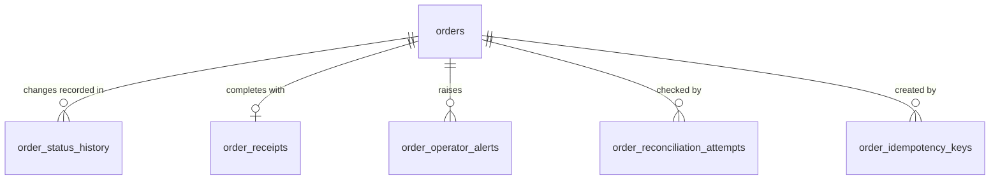

# Order Service — Database Choice and Schema

D3 Part 1.1. Ticket: ORD-14 (#232). The lifecycle these tables carry is in
[`order-service/README.md`](../../order-service/README.md); the API is in
[`contracts/order-service.openapi.yaml`](../../contracts/order-service.openapi.yaml).

## 1. Database: PostgreSQL

**Why, for errands specifically**

- **Every step of an errand is several writes that must land together.** Accepting an errand changes
  its status, courier and version, appends a history row, and queues a status message. Confirming
  receipt also queues the transfer request for the Credit Service. If any of these were saved without
  the others, a courier could be paid for an errand that never completed, or an errand could complete
  without anyone being told. One ACID transaction commits them all or none. The outbox (messages saved
  in the transaction, published afterwards) and the inbox (each received message recorded in the
  transaction it causes) only work because of this.
- **Students race each other, and the database decides who wins.** Many couriers may accept the same
  errand, and a requester may cancel just as a courier accepts. A conditional
  `UPDATE … WHERE status = 'OPEN' AND version = $n` and a `SELECT … FOR UPDATE` row lock give exactly
  one winner, with every loser told why (see *Races and corner cases* in the README). Two instances of
  the service, or a timer and a student, cannot both change the same errand.
- **The rules are enforced in the database as well as the code.** `CHECK` constraints keep the status
  in the closed set of twelve, the reward between 1 and 5, a courier on every assigned state, and the
  Credit Service's reference on every completed, cancelled or expired errand. A unique `(order_id, order_version)` index allows one
  history row per change, and triggers make the history, receipts, alerts and reconciliation log
  append-only. A bug in a later code path cannot write an impossible errand.
- **One clock for every deadline.** The acceptance, pickup, delivery and auto-confirmation timers all
  compare against the database's `now()`, so a student's action and a timer on another instance agree on
  whether a deadline has passed.
- **The reads are a few fixed, indexed patterns.** Open errands by acceptance deadline, a student's
  errands by requester or courier, disputes by referred administrator, and the timers' scans by status.
  Each has a B-tree index; the timer and open-list indexes are partial (only rows in that status), so
  they stay small however many errands have finished.
- **The parts that vary in shape fit JSONB on the same row.** The supplier snapshot and the item list
  are always read whole with their errand and never queried field by field, so a `jsonb` column keeps
  one errand one row, with no join.
- **Scale is one campus.** Thousands of errands a term and a few writes a second at peak. ORD-12 (#181)
  measures the targets on 10,000 errands with 100 concurrent users. A single primary serves that; nothing
  needs sharding or a cache in front.
- **Team consistency.** Every FoC service runs on the same PostgreSQL server, each with its own database
  and role (ADR 0003), so there is one engine to run, back up and learn.

**Considered and rejected:**

- **A document store (MongoDB).** It would hold an errand as one document, but the guarantees above (one
  winner under concurrency, a history row and an outbox message committed with the change, cross-row
  uniqueness) would need multi-document transactions and application checks in place of constraints.
- **Event sourcing** (store only the events, rebuild the errand from them). The history table already
  records every change for audit. Rebuilding state on every read would add projections to maintain and
  make the race rules harder to state, for no requirement that needs it.
- **Redis or another in-memory store.** Not durable enough to be the record of who owes whom credits.

## 2. Schema

Forward-only migrations in `order-service/drizzle/`, generated from `order-service/src/db/schema.ts`
(custom migrations for triggers and backfills). Order IDs are UUIDs. User IDs (`requester_id`,
`courier_id`, `referred_admin_id`) are text references to the User Service, with no foreign key: no
service constrains another's tables (ADR 0003). All timestamps are `timestamptz` (UTC).

`outbox_events`, `processed_events` and `dead_letters` hold messages, keyed by the errand ID as text
rather than a foreign key.

### `orders`

One row per errand, updated in place as it moves; `order_status_history` keeps what it was.

| Column | Type | Notes |
| --- | --- | --- |
| `order_id` | uuid PK | |
| `requester_id` | text NOT NULL | The student who posted it. |
| `courier_id` | text NULL | The current courier. Required in ACCEPTED, PICKED\_UP, DELIVERED, DISPUTED, COMPLETION\_PENDING\_CREDIT and COMPLETED (`orders_courier_shape`); cleared when a courier withdraws, times out or is suspended. Past couriers are in the history. |
| `referred_admin_id` | text NULL | The one administrator who may read and decide a dispute. Set and cleared by the scheduler. |
| `supplier_snapshot` | jsonb NOT NULL | The pickup location: `{ supplierId, name, type, building, floor, locationDescription }`, copied from the Supplier Service at creation. Later edits to the supplier, or its deactivation, do not change it. `supplierId` stays as the live reference. |
| `items` | jsonb NOT NULL | `[{ name, quantity, note? }]`, 1–50 items; a non-empty array (`orders_items_array`). Notes are private to the participants. |
| `delivery_zone` | text NOT NULL | Public, 1–200 chars: where couriers are heading. |
| `delivery_instructions` | text NOT NULL | Private, 1–1000 chars: the exact drop-off. |
| `reward` | integer NOT NULL | Credits, 1–5 (`orders_reward_range`). Reserved by the Credit Service until the errand ends. |
| `status` | text NOT NULL | One of the twelve states (`orders_status_enum`). |
| `version` | integer NOT NULL DEFAULT 1 | Bumped on every change. A command carries the version it read, and a stale one is refused. |
| `release_reason` | text NULL | `CANCELLED` or `EXPIRED`, set on the move to RELEASE\_PENDING\_CREDIT; decides which terminal state the release confirmation leads to. |
| `rejection_reason`, `available_at_rejection` | text / integer NULL | Why Credit refused the reservation, and the balance it reported. Present exactly when REJECTED (`orders_rejection_shape`). |
| `acceptance_deadline_at` | timestamptz NULL | Set when the errand opens; extended if a courier is suspended. |
| `non_delivery_report_at`, `auto_confirm_at` | timestamptz NULL | Deadlines saved when the delivery and confirmation periods start, so a later configuration change does not move them (ADR 0006). |
| `accepted_at`, `picked_up_at`, `delivered_at`, `completion_requested_at`, `completed_at`, `release_requested_at`, `released_at` | timestamptz NULL | When each step happened. |
| `credit_transaction_id` | uuid NULL | The Credit Service's transfer or release reference. Required once COMPLETED, CANCELLED or EXPIRED (`orders_completed_shape`, `orders_released_shape`). |
| `created_at`, `updated_at` | timestamptz NOT NULL | |

**Indexes:** `(status, created_at)`, `(requester_id, created_at)`, `(courier_id, created_at)` and
`(referred_admin_id, created_at)` for the lists; partial indexes on `acceptance_deadline_at` where OPEN,
`accepted_at` where ACCEPTED and `auto_confirm_at` where DELIVERED for the open list and the timers.

### `order_status_history` (append-only)

One row per change, written in the same transaction as the change: `previous_status`, `new_status`,
`action`, `actor_type` (`REQUESTER`, `COURIER`, `STUDENT`, `ADMIN`, `CREDIT_SERVICE` or `SYSTEM`),
`actor_id`, `reason`, `order_version` and `occurred_at`. `reason` holds an administrator's decision
reason, or which administrator a referral names. The unique `(order_id, order_version)` index means two
writers can never both record version *n*. A trigger refuses every `UPDATE` and `DELETE`.

### `order_receipts` (append-only)

The completion record, written in the same transaction as the Credit Service's transfer confirmation:
requester, courier, supplier snapshot, reward, the unique `credit_transaction_id`, and the time of each
step. `delivered_at` is null when an administrator completed the errand before any delivery was
recorded. A trigger refuses every `UPDATE` and `DELETE`, so what a completed errand says cannot change.

### `order_idempotency_keys`

`(requester_id, idempotency_key)` primary key, the `order_id` it created, and a hash of the request.
Saved with the errand, so a retried create returns the same errand, and reusing a key with a different
request is refused.

### `processed_events` (the inbox)

`(consumer, event_id)` primary key. Each message received is recorded in the transaction it causes, so
a redelivered reply finds its row and changes nothing.

### `outbox_events`

Messages waiting to be published, inserted in the transaction that caused them: `event_type`,
`aggregate_id` (the errand), `payload`, `correlation_id`, `causation_id`, and the relay's `attempts`,
`last_error`, `next_attempt_at` and `published_at`. `seq` is insertion order, which the relay publishes
in. Relays on several instances take rows with `FOR UPDATE SKIP LOCKED`, so each row is sent by one.

### `dead_letters`

Messages that failed every retry, kept for an operator to read and redrive, with the queue, failure
reason, body and properties. A row is never deleted and changes once, to record its redrive.

### `order_operator_alerts` (append-only)

One row per errand and kind: `CREDIT_WAIT_EXCEEDED` (the reservation is taking too long),
`CREDIT_STATE_CONFLICT` (Credit's record disagrees with the errand) and `REFERRAL_UNASSIGNED` (no
administrator may take the dispute).

### `order_reconciliation_attempts` (append-only)

Every check the reconciliation job makes against the Credit Service: the errand's status and version,
what Credit reported, and what the job did (`REISSUED` the request, `ALERTED` an operator, or found Credit
`CREDIT_UNAVAILABLE`).
