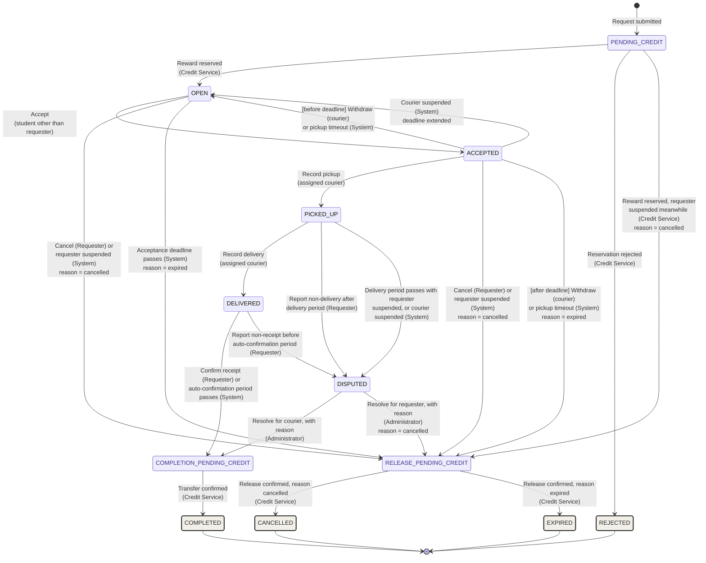

# State Table
**Order lifecycle.** The Order Service requirements refer to the states and transitions below. Any transition not listed is not permitted. The last column is what the web app shows for each state.

| State | Meaning | Final | Web app shows |
| ----- | ----- | :---: | ----- |
| PENDING\_CREDIT | The request is submitted and waiting for the Credit Service to reserve its reward. Couriers cannot see it. | No | Waiting for credits |
| OPEN | The reward is reserved and the order is waiting for a courier to accept it. | No | Open |
| ACCEPTED | A courier is assigned and the order is waiting for pickup. | No | Accepted |
| PICKED\_UP | The courier has collected the items and the order is waiting for delivery. | No | In transit |
| DELIVERED | The courier has recorded delivery and the order is waiting for the requester to confirm receipt or report non-receipt. | No | Delivered, confirm receipt |
| DISPUTED | The order is referred to an administrator and is waiting for their decision. | No | With an administrator |
| COMPLETION\_PENDING\_CREDIT | Delivery is accepted and the order is waiting for the Credit Service to transfer the reward to the courier. | No | Paying the courier |
| RELEASE\_PENDING\_CREDIT | The order is ending without payment and is waiting for the Credit Service to return the reward to the requester; the order records a release reason of cancelled or expired. | No | Returning credits |
| REJECTED | The reward could not be reserved and no credits are held. | Yes | Not placed |
| COMPLETED | The reward has been transferred to the courier. | Yes | Complete |
| CANCELLED | The reward has been returned to the requester after a cancellation or a dispute resolved for the requester. | Yes | Cancelled |
| EXPIRED | The reward has been returned to the requester because the acceptance deadline passed without a courier keeping the order. | Yes | Expired |

The web app takes these labels, with a plain-language explanation of each state, from `web-app/src/lib/order-status.ts`.

# Transition Table
**Guard** is what must also be true, beyond the order being in the From state and the actor being allowed. If a guard fails, the order does not change and the caller is refused. Every student and administrator action also needs an active account: a suspended caller is refused before any guard is checked. A reply from the Credit Service is acted on only if it names the same order and amount the request did.

**Credit** is what happens to the reward. The Order Service only asks; the Credit Service moves the credits and replies, and until it does the reward stays reserved from the requester's available credits (see *Waiting for the Credit Service*).

**Emits** is what the transition sends, written to the outbox in the same transaction (see *Sending and receiving safely*). Every status change sends `order.status-changed`; naming or clearing a dispute's administrator keeps the status and sends nothing. A transition into a `*_PENDING_CREDIT` state also sends the request that state waits for.

**Refused with** is the error when that row's guard fails. Any command is also refused, with nothing changed, when it does not fit the errand: `404 NOT_FOUND` if the caller may not see it, `403 ACTION_FORBIDDEN` if the caller may never take that action on it, `409 INVALID_ORDER_STATE` if it is in another state, and `409 ORDER_CHANGED` if the `expectedVersion` sent is not the current one. Each 403 and 409 carries the current status and version. Credit Service replies and timers are never refused: a reply that does not match its request is set aside for an operator, and a timer that finds the errand already moved on does nothing.

| From | Trigger | Actor | Guard | To | Credit | Emits | Refused with |
| ----- | ----- | ----- | ----- | ----- | ----- | ----- | ----- |
| — | Create | Student | Supplier exists and is active; the request is valid | PENDING\_CREDIT | Reservation requested | `order.reservation-requested`, `order.status-changed` | 422 `VALIDATION_FAILED`; 422 `INVALID_SUPPLIER`; 400 `IDEMPOTENCY_KEY_REQUIRED`; 422 `IDEMPOTENCY_KEY_REUSED`; 503 `SUPPLIER_SERVICE_UNAVAILABLE` |
| PENDING\_CREDIT | Reward reserved | Credit Service | Requester not suspended | OPEN | Reserved | `order.status-changed` | — |
| PENDING\_CREDIT | Reward reserved | Credit Service | Requester suspended while waiting | RELEASE\_PENDING\_CREDIT (cancelled) | Reserved, then release requested | `order.release-requested`, `order.status-changed` | — |
| PENDING\_CREDIT | Reservation rejected | Credit Service | — | REJECTED | None; nothing was reserved | `order.status-changed` | — |
| OPEN | Accept | Student | Actor is not the requester; acceptance deadline not passed | ACCEPTED | None; stays reserved | `order.status-changed` | 403 `SELF_ACCEPTANCE_FORBIDDEN`; 409 `ACCEPTANCE_DEADLINE_PASSED`; 409 `ORDER_NOT_OPEN` once taken or closed |
| OPEN | Cancel | Requester | — | RELEASE\_PENDING\_CREDIT (cancelled) | Release requested | `order.release-requested`, `order.status-changed` | — |
| OPEN | Requester suspended | System | — | RELEASE\_PENDING\_CREDIT (cancelled) | Release requested | `order.release-requested`, `order.status-changed` | — |
| OPEN | Acceptance deadline passes | System | — | RELEASE\_PENDING\_CREDIT (expired) | Release requested | `order.release-requested`, `order.status-changed` | — |
| ACCEPTED | Record pickup | Assigned courier | — | PICKED\_UP | None; stays reserved | `order.status-changed` | — |
| ACCEPTED | Cancel | Requester | — | RELEASE\_PENDING\_CREDIT (cancelled) | Release requested | `order.release-requested`, `order.status-changed` | — |
| ACCEPTED | Requester suspended | System | — | RELEASE\_PENDING\_CREDIT (cancelled) | Release requested | `order.release-requested`, `order.status-changed` | — |
| ACCEPTED | Withdraw or pickup timeout | Assigned courier (withdraw) or System | Acceptance deadline not passed | OPEN | None; stays reserved | `order.status-changed` | — |
| ACCEPTED | Withdraw or pickup timeout | Assigned courier (withdraw) or System | Acceptance deadline passed | RELEASE\_PENDING\_CREDIT (expired) | Release requested | `order.release-requested`, `order.status-changed` | — |
| ACCEPTED | Courier suspended | System | — | OPEN, with the courier removed and the acceptance deadline extended by the time they held the order | None; stays reserved | `order.status-changed` | — |
| PICKED\_UP | Record delivery | Assigned courier | — | DELIVERED | None; stays reserved | `order.status-changed` | — |
| PICKED\_UP | Report non-delivery | Requester | Delivery period since pickup has passed | DISPUTED | None; stays reserved | `order.status-changed` | 409 `DELIVERY_PERIOD_NOT_PASSED` |
| PICKED\_UP | Delivery period passes, or requester suspended | System | Requester suspended and delivery period passed | DISPUTED | None; stays reserved | `order.status-changed` | — |
| PICKED\_UP | Courier suspended | System | — | DISPUTED | None; stays reserved | `order.status-changed` | — |
| DELIVERED | Confirm receipt | Requester | — | COMPLETION\_PENDING\_CREDIT | Transfer to the courier requested | `order.completion-requested`, `order.status-changed` | — |
| DELIVERED | Auto-confirmation period passes | System | — | COMPLETION\_PENDING\_CREDIT | Transfer to the courier requested | `order.completion-requested`, `order.status-changed` | — |
| DELIVERED | Report non-receipt | Requester | Auto-confirmation period not passed | DISPUTED | None; stays reserved | `order.status-changed` | 409 `AUTO_CONFIRMATION_PASSED` |
| DISPUTED | Referred to an administrator, or referral cleared | System | See *Administrator referral and decision* | DISPUTED (unchanged) | None; stays reserved | Nothing | — |
| DISPUTED | Resolve for courier | Administrator the dispute is referred to | A reason is given; the administrator was never the errand's requester or courier | COMPLETION\_PENDING\_CREDIT | Transfer to the courier requested | `order.completion-requested`, `order.status-changed` | 422 `VALIDATION_FAILED`; 403 `CONFLICT_OF_INTEREST`; 403 `NOT_REFERRED_ADMIN` |
| DISPUTED | Resolve for requester | Administrator the dispute is referred to | A reason is given; the administrator was never the errand's requester or courier | RELEASE\_PENDING\_CREDIT (cancelled) | Release requested | `order.release-requested`, `order.status-changed` | 422 `VALIDATION_FAILED`; 403 `CONFLICT_OF_INTEREST`; 403 `NOT_REFERRED_ADMIN` |
| COMPLETION\_PENDING\_CREDIT | Transfer confirmed | Credit Service | — | COMPLETED | Transferred: the courier's available credits rise by the reward | `order.status-changed` | — |
| RELEASE\_PENDING\_CREDIT | Release confirmed | Credit Service | Recorded reason is cancelled | CANCELLED | Released: back to the requester's available credits | `order.status-changed` | — |
| RELEASE\_PENDING\_CREDIT | Release confirmed | Credit Service | Recorded reason is expired | EXPIRED | Released: back to the requester's available credits | `order.status-changed` | — |

# Timers
The periods come from the D1 backlog and are configurable. The delivery and auto-confirmation
deadlines are saved on the order when their period starts, so a later change to a period does not
move an existing deadline.

| Timer | Starts when | Length | When it runs out |
| ----- | ----- | ----- | ----- |
| Acceptance deadline | The order becomes OPEN | 60 minutes | An OPEN order expires. An ACCEPTED order keeps its courier, but a later withdrawal or pickup timeout expires it instead of reopening it. A courier suspension extends the deadline by the time that courier held the order. |
| Pickup | A courier accepts | 30 minutes | The courier is removed, handled as a withdrawal. |
| Delivery | The courier records pickup | 2 hours | The requester may report non-delivery. If the requester is suspended, the order is referred automatically, at the end of the period or at the suspension if the period has already passed. |
| Auto-confirmation | The courier records delivery | 24 hours | Receipt is confirmed, unless the requester has already confirmed or reported non-receipt. From then a report of non-receipt is refused. |
| Credit wait | The order enters PENDING\_CREDIT | 5 minutes | An operator is alerted. The order is not rejected, and still opens if the reservation arrives. |

# Waiting for the Credit Service
While an order is in any `*_PENDING_CREDIT` state, no participant action, administrator action or timer changes it; only the Credit Service's reply does.

- **Credit Service down.** Requests wait in the broker. The order moves on once the Credit Service replies; nobody has to resubmit.
- **Transfers and releases do not fail as a business outcome.** The credits are already reserved, so a transfer or release has no reason to be refused. A missing reply leaves the order pending for retry or support handling (D1 OS-FR5.1.2); reconciliation (ORD-09) re-sends the same request, which the Credit Service applies at most once.
- **Messages that cannot be processed** are retried five times and then dead-lettered for an operator. They are never dropped.
- **The release reason** (cancelled or expired) is kept on the order. The Credit Service does not need it and does not send it back.

# Races and corner cases
Each case has a test. The `*.postgres.test.ts` ones run against a real PostgreSQL database in CI, since the in-memory database used elsewhere runs one transaction at a time.

| Case | What happens | Test |
| ----- | ----- | ----- |
| Many couriers accept at once | One conditional update wins. The errand becomes ACCEPTED once, and every other courier gets `409 ORDER_NOT_OPEN`. | `test/order-acceptance.postgres.test.ts` |
| Acceptance races the acceptance deadline | The errand is accepted or expires, never both: one history row, and a release only if it expired. | `test/order-expiry.postgres.test.ts` |
| Acceptance races the requester's cancellation | Whichever commits first wins. If an acceptance wins, the cancellation, sent with the open errand's version, gets `409 ORDER_CHANGED` with the new status and version; the requester can still cancel the accepted errand by sending that version. If the cancellation wins, every acceptance gets `409 ORDER_NOT_OPEN` and no courier is assigned. Either way one release is requested at most. | `test/order-acceptance.postgres.test.ts` |
| Receipt confirmed twice | The first confirmation moves the errand to COMPLETION\_PENDING\_CREDIT and requests one transfer. A second one, sent at the same time or later, gets `409 INVALID_ORDER_STATE` and requests nothing, so the courier is paid once. | `test/order-completion.postgres.test.ts` |
| The requester's report, their confirmation and auto-confirmation land together | One outcome: one history row, and one transfer request only if the errand was confirmed, by the requester or the timer. The others are refused or skipped. | `test/order-outcomes.postgres.test.ts` |
| A reservation reply races the requester's suspension | The errand is never left open. Either the reply finds the requester suspended and cancels it, or it opens the errand and the suspension, waiting on the row lock, cancels it. One release is requested either way. | `test/participant-suspension.postgres.test.ts` |
| A supplier is renamed, moved or deactivated after an errand is posted | The errand keeps the copy of the supplier taken at creation, in its details and in the open list, and its receipt copies the same snapshot. Reading an errand never asks the Supplier Service again. A new errand for the deactivated supplier gets `422 INVALID_SUPPLIER`. | `test/order-creation.test.ts` |
| One student as requester and courier at once | Allowed. A student with an open errand of their own can accept, pick up and deliver another student's; `GET /orders/mine` lists both, with `myRole` `REQUESTER` and `COURIER`. They still cannot accept their own (`403 SELF_ACCEPTANCE_FORBIDDEN`). | `test/my-errands.test.ts` |

# Services it talks to

| Service | How | What for |
| ----- | ----- | ----- |
| Credit Service | Messages, both directions | Reserve, transfer and return each order's reward. Every `*_PENDING_CREDIT` state is waiting for one of its replies. |
| User Service | HTTP, through `@foc/auth-client` | Who is calling, whether they are an administrator, and that their account is active. Checked on every request; a suspension takes effect within 5 seconds. |
| User Service | HTTP, `GET /internal/admins` | Which administrators may act now, so the scheduler can refer each dispute to one. Called once per run, only while a dispute exists, with `INTERNAL_SERVICE_KEY`; if the User Service does not answer, referrals wait for the next run. |
| User Service | HTTP, `GET /internal/users/:id` | Whether a user is suspended now: on a suspension message, on a reservation reply while the order waits for it, and once for each picked-up errand whose requester was suspended within its delivery period, when that period ends. Asked with `INTERNAL_SERVICE_KEY`. If it does not answer, the message is retried or the scheduler tries again on its next run; the user is never assumed active. |
| User Service | Messages, received | Suspensions, which drive the "requester suspended" and "courier suspended" transitions (see *Participant suspension*). |
| Supplier Service | HTTP, `GET /suppliers/:id` | At creation: refuse an inactive supplier and keep a copy of the supplier on the order, so it survives later changes. The call carries the requester's own token, so the Supplier Service needs no service-to-service route. |
| Web app | HTTP | Every student and administrator command and query. |
| Any listener | Messages, sent | Each status change, for live updates and chat. It carries no private details. |

## Messages

Routing keys and executable payload schemas are in `platform/src/events/catalogue.ts`. Every
message below is catalogued. Credit's replies and suspensions arrive on durable queues of this
service's own (`foc.order.*`), shared by its instances, so each is handled once. Separately, each
instance has a private queue that drops cached identities on any status or role change (USR-07).

| Message | Direction | Carries | Schema |
| ----- | ----- | ----- | ----- |
| `order.reservation-requested` | Sent | order, requester, amount | In catalogue |
| `credit.reserved` | Received | order, requester, amount, restated so the reply can be checked against the request | In catalogue |
| `credit.reservation-rejected` | Received | the same, plus the reason: insufficient credits (with the available balance) or amount out of range | In catalogue |
| `order.completion-requested` | Sent | order, requester, courier, amount | In catalogue |
| `credit.transferred` | Received | request facts, transfer reference, and both resulting wallet balances (D1 OS-FR5.1.3) | In catalogue |
| `order.release-requested` | Sent | order, requester, amount | In catalogue |
| `credit.released` | Received | request facts, release reference, and requester resulting balance | In catalogue |
| `order.status-changed` | Sent | order, previous status, new status, when; no private fields | In catalogue |
| `user.suspended` | Received, on `foc.order.user-suspensions` | user, status, audit reference; only the user is read, and the User Service is asked whether they are still suspended | In catalogue |

## Sending and receiving safely

- **Sending.** A transition that sends a message writes it to this service's outbox table in the same database transaction as the status change. Nothing calls the publisher directly. The shared relay from EVT-02 (#135) publishes each row after commit, so a crash between saving and sending delays the message but never loses it. The outbox table arrives with the first order migration (ORD-01, ORD-02).
- **Receiving.** Each received message's id is recorded in the same transaction as the transition it causes, so a redelivered reply changes nothing (EVT-02).
- **Suspensions.** The User Service writes each suspension to its outbox and the shared relay publishes it. This service handles it once per message through the inbox, as above. Without a broker (running locally outside Compose), suspensions do not reach errands; a suspended user is still refused on every request.
- **A reply that arrives late (EVT-03).** Credit answers a re-sent request with its recorded result under a new event id, so a second `credit.reserved` can arrive after the errand has moved on. If the errand has changed since that confirmation was applied, the copy is acknowledged, logged and counted (`foc_events_stale_total`), and changes nothing; a copy that arrives while the errand is still where the confirmation left it (`OPEN`, or cancelled for a suspended requester) is a plain repeat. A second rejection for an errand that is already `REJECTED` is likewise a repeat. A reply that contradicts the record, such as a rejection for an errand that was reserved and accepted, is set aside as a dead letter for an operator.
- **`orderVersion`.** Every `order.status-changed` carries the errand's version after the change. Nothing in this service reads it: it is for a future consumer of that event, which keeps the highest version it has applied and ignores anything at or below it ([ADR 0009](../docs/adr/0009-messaging-rabbitmq-events-and-ordering.md)).

## Persistence and projections

Why PostgreSQL, and every table and column: [`docs/order-service/schema.md`](../docs/order-service/schema.md).

The generated migration under `order-service/drizzle/` creates the Order-owned `orders`,
`order_status_history`, `order_idempotency_keys`, `processed_events`, and `outbox_events` tables.
Database constraints enforce the closed
status set, reward range, non-empty item list, version counter, terminal rejection shape, and the
courier required by assigned/delivery states. `order_status_history` records the previous and new
status, action, actor, an optional reason, order version, and timestamp; one history row is permitted
per order version.

`src/orders/order-state-machine.ts` is the executable source for transition, actor, guard, and emitted
event rules. The generated matrix test evaluates every status × action × actor combination and checks
reachability and exits, while the table above remains its human-readable counterpart. XState is not
used: the lifecycle is a finite declarative table and introducing another runtime would add a second
representation without improving the current guard model. Revisit this if parallel/nested states are
introduced.

`GET /orders/:id` returns an authenticated projection. Exact delivery instructions and participant IDs
are visible only to the requester, assigned courier, or the administrator named by a referral.
`PENDING_CREDIT` and `REJECTED` errands are private to their requester, and absent resources and
hidden private resources both return `404` to avoid revealing their existence. The complete schema is in
`contracts/order-service.openapi.yaml`.

`POST /orders` requires an active authenticated requester and an `Idempotency-Key`. It validates the
entire request, fetches an active Supplier and captures its snapshot, then commits the private
`PENDING_CREDIT` row, initial history, idempotency claim, public status fact, and
`order.reservation-requested` outbox row in one transaction. A replay with the same requester, key,
and body returns the recorded order without contacting Supplier again; reuse with different facts is
refused. The shared relay publishes committed rows after the transaction, so Credit downtime delays
opening but never rejects or loses the errand. Credit's validated reply moves the row to `OPEN` with
its acceptance deadline, to terminal `REJECTED` with the recorded reason and available balance, or,
if the requester was suspended while it waited, to `RELEASE_PENDING_CREDIT` (cancelled; see
*Participant suspension*).
The transactional inbox and business-state check make 100 duplicate replies one transition.

`CREDIT_WAIT_TIMEOUT_MS` defines when a `PENDING_CREDIT` row is surfaced to an operator (ORD-09,
below); creation never rejects it merely because the timer passes. `created_at`, status, and the existing
`orders_status_created_idx` provide the durable discovery boundary that recovery will consume.

`GET /orders` returns at most 100 unexpired `OPEN` errands ordered by acceptance deadline, leaving
out the caller's own (they are in `GET /orders/mine`). Its structured item summary omits item notes,
exact delivery instructions, participant IDs, and every pending or rejected order. `GET /orders/:id`
gives that same public projection to an unrelated student. A caller can explicitly request
`?view=private`; only the requester, assigned courier, or the administrator named in
`referred_admin_id` receives it, and every other caller receives `403`. The scheduler sets and
clears `referred_admin_id` for disputes (see *Administrator referral and decision*).

`GET /orders/mine` returns `{ items, truncated }`: the caller's errands in any status, as requester
or current courier, each in its private projection with `myRole` (`REQUESTER` or `COURIER`). It is
ordered by most recent change, at most 100, with no paging yet; `truncated` is true when older
errands were left out. A courier who withdrew or timed out is no longer on the errand, so it drops
out of their list. This is also "a courier's assigned orders" (D3 Part 1.3): the items whose
`myRole` is `COURIER`. Optional `role=REQUESTER|COURIER` and `active=true|false` query parameters
filter before the 100-item limit. Active excludes rejected, completed, cancelled and expired orders.

`GET /admin/orders` is an administrator's view of errands. With an account (ORD-15),
`?requesterId=` lists the errands that student posted, in any status, `?courierId=` the ones they
currently hold as courier, and both together narrow to errands matching both. With neither, it
lists every errand, live and past (ADM-06). `?status=` narrows either to one or more statuses,
comma-separated (`?status=DISPUTED`, `?status=OPEN,ACCEPTED`). It is newest first and paged
(`page`, `pageSize` up to 100, default 20), answering `{ items, page, pageSize, total }`. The
console pages with `?before=<orderId>`, the last errand it showed, instead of `page`: a keyset, so
errands posted since, or ones that leave a status filter, neither repeat nor skip rows; `total`
then counts the errands from there on. An `(created_at, order_id)` index serves the list. Each item
is the public projection, without participant IDs, delivery instructions or item notes, even for an
errand referred to the caller: those are read one errand at a time through `GET /orders/:id`.
Students get `403`; an unknown parameter or status gets `422 VALIDATION_FAILED`.

`POST /orders/:id/accept` requires the version observed during discovery. A single conditional
`UPDATE` checks `OPEN`, that exact version, a live deadline, and that the courier is not the
requester. The winner becomes the sole courier at version + 1; history and the privacy-safe status
event commit in the same transaction. Every loser receives `409` with the current status and
version. Authentication fails closed for suspended accounts, and acceptance deliberately performs
no Credit balance check: a zero-credit student must be able to earn credits by delivering.

### Fulfilment, completion and receipt (ORD-04)

`POST /orders/:id/pickup` and `POST /orders/:id/deliver` (assigned courier) and
`POST /orders/:id/confirm-receipt` (requester) each take `{ "expectedVersion" }`. Every lifecycle
command after acceptance goes through one repository path: it locks the row, resolves the caller's
role against the order (requester, assigned courier, other student, administrator), asks the
executable transition table for a decision, and only then writes the version-checked update, the
history row and every emitted event in one transaction. A caller who may never do the action gets
`403 ACTION_FORBIDDEN`; a wrong state gets `409 INVALID_ORDER_STATE`; a stale version gets
`409 ORDER_CHANGED`. Each carries the current status and version, and none of them changes anything.

Confirmation moves the order to `COMPLETION_PENDING_CREDIT` and writes `order.completion-requested`
(order, requester, courier, reward) to the outbox. No participant, administrator or timer action
exists from that state in the transition table, so only Credit's reply can move it (OS-FR7.1.3).
`credit.transferred` is accepted only from `credit-service`, through the transactional inbox, and
only if it restates the recorded requester, courier and amount. A mismatch, an unknown order, or an
order not waiting for a transfer changes nothing and is dead-lettered for an operator. Credit has
no transfer-failure event, so an unconfirmed transfer simply stays pending. A confirmation repeated
under a new event ID with the same transaction is a no-op; a different transaction is refused.

The confirming transaction records `completed_at` and the Credit transaction ID, and writes the
`order_receipts` row: order, requester, courier, supplier snapshot, reward, every state timestamp and
the Credit transaction reference (OS-FR5.1.2). `GET /orders/:id/receipt` returns it to the
participants and the referred administrator. Database triggers make `order_receipts` and
`order_status_history` append-only.

### Cancellation, withdrawal and expiry (ORD-05)

`POST /orders/:id/cancel` (requester, `OPEN` or `ACCEPTED`) and `POST /orders/:id/withdraw`
(assigned courier, `ACCEPTED`) take `{ "expectedVersion" }` and use the same transition path.
Cancelling moves the order to `RELEASE_PENDING_CREDIT` with reason `CANCELLED`. A withdrawal removes
the courier: before the acceptance deadline the order reopens with its deadline unchanged, and
after it the order moves to `RELEASE_PENDING_CREDIT` with reason `EXPIRED`. Every move into
`RELEASE_PENDING_CREDIT` writes exactly one `order.release-requested` in the same transaction.
`PICKED_UP` and later states refuse cancellation. While the release is pending, a participant's view
returns the reason as `releaseReason`, the status the errand will end in.
A release caused by a suspension or an administrator's decision reads `CANCELLED`, as its final
status will, so the field says nothing that status does not.

The **lifecycle scheduler** owns every timer. It runs once as soon as the service is ready and then
every `LIFECYCLE_SWEEP_INTERVAL_MS` (at most 60 s, enforced at boot). An `OPEN` order past its
deadline expires. An `ACCEPTED` order whose `accepted_at` is older than `PICKUP_TIMEOUT_MS` loses
its courier and follows the withdrawal path. Due timers are found with the database clock, then each
one fires through the ordinary transition path: the row is locked and the timer is re-checked under
the lock. So a timer that fell due during downtime fires within one interval of restart, overlapping
sweeps or instances apply it exactly once, and accept-versus-expire is settled by the row's version:
acceptance's conditional update requires `acceptance_deadline_at > now()`, and expiry requires
`OPEN` at the locked version.

`credit.released` from `credit-service` closes the order as `CANCELLED` or `EXPIRED` according to the
recorded reason. It records `released_at` and the Credit transaction ID, with the same matching,
dead-lettering and duplicate rules as a transfer. A release for a completed order, or a transfer for
a released one, is refused, so transfer and release are mutually exclusive outcomes. A suspended
courier's errand reopens with its deadline extended instead (see *Participant suspension*).

### Administrator referral and decision (ORD-11)

Every `DISPUTED` errand is referred to one administrator, who alone reads its private details and
decides it. The move into `DISPUTED` commits with no administrator; the lifecycle scheduler refers it
on its next run. It asks the User Service once for the administrators who may act
(`GET /internal/admins`: active, holding the role, and past the bootstrap password), then:

1. A dispute referred to someone not on that list (suspended, demoted, or unknown) has the referral
   cleared (`ADMIN_UNASSIGNED`).
2. A dispute referred to no one is referred (`ADMIN_ASSIGNED`) to the listed administrator with the
   fewest undecided disputes, leaving out anyone who was ever the errand's requester or courier
   (including a courier who withdrew or timed out); ties go to the fewest referrals kept overall,
   then the lower user ID.

Both go through the ordinary transition path under the row lock: the status stays `DISPUTED`, the
version moves (so a replaced administrator's decision is stale), a history row naming the
administrator in its `reason` is written, and no message is sent. Each run takes up to its batch
size of disputes needing one of these, oldest first; disputes already with an administrator who may
act are not in that batch, so they never hold up a newer one. If the User Service does not answer,
or answers that there are no administrators at all, nothing is cleared or referred, a warning is
logged, and the next run tries again; timers are unaffected. An empty list is not trusted to clear
referrals: there would be no one to refer them to, and a request from anyone who has really lost the
role is already refused. If administrators are listed but every one took part in the errand, one
`REFERRAL_UNASSIGNED` operator alert is recorded for the errand, however many runs see it, and every
such run logs a warning until the errand is referred.

`POST /admin/orders/:id/resolve` takes `{ "outcome": "COURIER" | "REQUESTER", "reason",
"expectedVersion" }`, with a reason of 1 to 500 characters (trimmed). `COURIER` moves the errand to
`COMPLETION_PENDING_CREDIT` and requests the transfer; `REQUESTER` moves it to
`RELEASE_PENDING_CREDIT` (cancelled) and requests the release. The reason is kept on the history row
with the administrator and time; that row is the record of the decision. An administrator who was
ever the errand's requester or courier gets `403 CONFLICT_OF_INTEREST`; any other administrator than
the referred one gets `403 NOT_REFERRED_ADMIN` (checked again under the row lock); a repeated or
stale decision gets `409` and requests nothing. A dispute raised before delivery and resolved for the
courier completes with a receipt whose `deliveredAt` is null.

`GET /admin/orders/referred` lists the caller's referrals with their private details and every
dispute referred to no one yet without them, each with `referredBy` (the action that disputed it) and
`assignedToMe`. `GET /admin/orders/decisions` shows every administrator the 100 most recent
decisions: errand, administrator, outcome, reason and time.

### Requester outcomes and auto-confirmation (ORD-10)

`POST /orders/:id/report-non-delivery` and `POST /orders/:id/report-non-receipt` (requester) take
`{ "expectedVersion" }` and use the same transition path. Both move the errand to `DISPUTED`, where
the scheduler refers it to an administrator (above).

Recording pickup saves `non_delivery_report_at` (pickup plus `DELIVERY_PERIOD_MS`), and recording
delivery saves `auto_confirm_at` (delivery plus `AUTO_CONFIRM_MS`), in the same update as the move
(ADR 0006). Both are set and checked against the database clock, which the scheduler also uses, so
a report and a timer agree on whether a deadline has passed. A participant's view returns each one,
as `nonDeliveryReportAt` while `PICKED_UP` and `autoConfirmAt` while `DELIVERED`, so the requester
can see when they may report and when silence counts as confirmation. A check constraint refuses a
picked-up or delivered errand without its deadline, so code that leaves one out fails loudly instead
of leaving an errand no one can report and no timer confirms.

- A non-delivery report before `non_delivery_report_at` gets `409 DELIVERY_PERIOD_NOT_PASSED`.
- A non-receipt report is accepted until `auto_confirm_at`. From then the errand counts as
  confirmed, and a report gets `409 AUTO_CONFIRMATION_PASSED` even before the scheduler has
  recorded the confirmation.
- The scheduler confirms each `DELIVERED` errand past `auto_confirm_at` (`AUTO_CONFIRM`), re-checked
  under the row lock. Like the requester's confirmation, it writes one `order.completion-requested`.
  Whichever of a confirmation, a report or the timer lands second is refused or skipped, so an
  errand has one outcome and at most one transfer request.
- No timer changes a `DISPUTED` errand.

The migration that adds the two columns gives errands already picked up or delivered their
deadlines from the D1 periods (2 hours and 24 hours), since a migration cannot read the
environment. On a database holding errands delivered more than 24 hours earlier, the first sweep
after it confirms them, 100 per run.

### Participant suspension (ORD-06)

An errand refers to users by ID only: its requester, its current courier and the administrator a
dispute is referred to on the order; who acted on each history row; and the requester and courier
on its receipt. It keeps no copy of a name, email, status or role, so a change to any of those
needs nothing from this service except two:

- **A suspension** changes the user's errands, below.
- **An administrator who loses the role or is suspended** has their referrals cleared and given to
  another administrator on the scheduler's next run (see *Administrator referral and decision*).

A reactivation changes nothing: an errand already cancelled, reopened or referred stays so. A
suspended user is refused on every request within 5 seconds, whatever happens to their errands.

The User Service publishes `user.suspended` and this service handles it from the durable queue
`foc.order.user-suspensions`. The message is only a prompt: the handler first asks the User Service
(`GET /internal/users/:id`) whether the user is suspended now, and does nothing if they are not, so
a stale or forged message cannot change an errand. It then locks every errand the user requested or
is courier of that is not yet delivered, in `order_id` order (so the requester's and the courier's
suspensions handled at once wait for each other instead of deadlocking), and applies through the
ordinary transition path:

| User is | Errand in | History action | Result |
| ----- | ----- | ----- | ----- |
| Requester | `OPEN`, `ACCEPTED` | `REQUESTER_SUSPENDED` | `RELEASE_PENDING_CREDIT` (cancelled): the reserved credits go back to the requester |
| Requester | `PICKED_UP`, delivery period passed | `DELIVERY_PERIOD_PASSED` | `DISPUTED`, referred to an administrator |
| Requester | `PICKED_UP`, within the delivery period | — | Unchanged but marked. The scheduler refers it when the period ends, if the requester is still suspended then |
| Courier | `ACCEPTED` | `COURIER_SUSPENDED` | `OPEN`. The courier is removed (and with them their private access), and the acceptance deadline moves later by the time they held the errand |
| Courier | `PICKED_UP` | `COURIER_SUSPENDED` | `DISPUTED`, referred to an administrator; the courier stays on the errand, so a decision for the courier still pays them |

Anything else is left alone. A delivered errand is confirmed or auto-confirmed as usual, so credits
keep moving for work already done (CS-FR1.2.1), and an errand already in dispute or waiting on the
Credit Service is not changed. No suspension moves credits except the requester's cancellation.

Every outcome's history row gives its reason, `requester suspended` or `courier suspended`,
including the two below that happen later: the scheduler's referral and the cancellation when the
reservation arrives. Only the referred administrator reads that row as written; what everyone else
sees is at the end of this section.

- **While the errand waits for its reservation.** A requester suspended while their errand is in
  `PENDING_CREDIT` is caught when Credit's reservation arrives: the reply handler asks the User
  Service and, if the requester is suspended, cancels the errand instead of opening it. It locks
  the errand before asking, and the suspension handler locks the requester's waiting errands too,
  so whichever runs second sees what the other did: either the reply finds the requester suspended,
  or the suspension finds the errand already `OPEN` and cancels it.
- **At the end of the delivery period.** A suspension within the period marks the errand
  (`requester_suspended_at`). Once the period has passed, the scheduler asks the User Service about
  the requester of each marked errand, oldest deadline first, and refers it
  (`DELIVERY_PERIOD_PASSED`) if they are still suspended. If they are active again, it clears the
  mark and the errand stays `PICKED_UP` (the requester may report non-delivery). So each errand is
  asked about once, and only errands whose requester was suspended are asked about at all. This
  runs apart from dispute referral, so a failed lookup cannot hold that back.
- **User Service down.** The suspension message and the reservation reply are retried (5 attempts
  over about 81 seconds) and then set aside as dead letters, changing nothing; a dead letter can be
  redriven from the operator view. A reservation reply set aside this way is also re-sent by
  reconciliation, since the errand is still `PENDING_CREDIT` (see *Credit reconciliation*). The
  scheduler logs a warning and tries again on its next run. A user is never assumed active.
- **Repeats.** A repeated message changes nothing (the inbox), and a later suspension of the same
  user finds nothing left to change. A second reservation reply under a new event ID (for example
  re-sent by reconciliation, then the original redriven) is a repeat too, once the errand has been
  opened or cancelled, whatever has happened to it since.
- **Connections.** The reservation reply and the suspension handler hold the errand's row lock, and
  so a pool connection, while they ask the User Service (up to its 5 s timeout). Each handles at
  most 3 messages at once (`LOCK_THEN_ASK_PREFETCH`), so together they hold at most 6 of the
  process's 10 pool connections and leave the rest for requests, the scheduler and the outbox
  relay.
- **An acceptance just before a suspension.** Authentication caches an account's status for up to 5
  seconds, so a courier's acceptance that passed it just before their suspension can commit after
  the handler has run. That errand stays `ACCEPTED` until the pickup timeout, then reopens, or
  expires if its acceptance deadline has passed, returning the credits. The suspended courier is
  refused once the cache expires, so they cannot record pickup and are never paid.

What the history shows everyone but the referred administrator was decided in #260 (2026-10-21). It
never names a suspension or who was suspended. Every change the system makes shows as
`SYSTEM_OUTCOME` by the system, with no actor or reason, whether a timer, a referral or a suspension
made it, and so does the Credit Service's cancellation for a suspended requester. An
administrator's decision always shows as made, whatever its reason says. So an errand reopened by
the system has the same action, actor and reason whether the courier's pickup time ran out or the
courier was suspended. The statuses and times are always the real ones, though, since hiding them
would make the history false, and a suspension can still be worked out from these:

- **`ACCEPTED` to `RELEASE_PENDING_CREDIT` with the courier still on the errand.** Only the
  requester's suspension does this. A pickup timeout past the acceptance deadline makes the same
  change but removes the courier. So the courier can tell that the requester was suspended.
- **`PICKED_UP` to `DISPUTED` by the system.** Only a suspension of the courier or of the requester
  does this; otherwise the requester reports non-delivery themselves. Each knows whether they were
  suspended, so they can tell that the other was.
- **A reopen too soon to be a pickup timeout.** A pickup timeout reopens an errand only once
  `PICKUP_TIMEOUT_MS` has passed since it was accepted, while a courier's suspension can reopen it
  at any time. A requester who sees it reopened sooner can tell that the courier was suspended.
- **A reopened errand's acceptance deadline moving later.** This is not in the history. A courier's
  suspension gives the requester back the time the courier held the errand, and a pickup timeout
  does not. The deadline is public, so anyone who sees the errand can notice it move, but only the
  requester knows who the courier was; anyone else learns only that some courier was suspended.

### Recovery and privacy verification (ORD-09)

- **Kill after commit (OS-NFR4.1.1).** Every transition writes its events to the outbox in its own
  transaction, and the relay publishes each row under the row's ID as the event ID.
  `order-recovery.postgres.test.ts` SIGKILLs a real process right after it commits a creation and a
  cancellation. A relay started afterwards publishes each committed event exactly once. A process
  SIGKILLed after the broker accepted an event, but before marking it published, has that event
  resent under the same ID, and a consumer's inbox applies it once.
- **Pending credit survives restarts (OS-NFR4.1.2).** A `PENDING_CREDIT` order is ordinary committed
  state. Its requester can read it at any age, and its reservation request is republished by the
  relay, so the order opens when Credit replies, with no manual step.
- **Operator surfacing (OS-FR1.1.3).** Each lifecycle sweep raises one `CREDIT_WAIT_EXCEEDED` alert
  for every order waiting longer than `CREDIT_WAIT_TIMEOUT_MS`. The alert is recorded once in the
  append-only `order_operator_alerts` table and logged as a structured `warn` line (`alert`,
  `orderId`, `waitingMs`). `GET /admin/orders/pending-credit` (administrators only) lists every such
  order with how long it has waited. The order is never rejected for waiting.
- **Privacy (OS-NFR5.1).** `GET /orders/:id/history` returns the private status history to the
  requester, the current courier and the referred administrator only. `order-privacy.test.ts` checks
  every read surface (detail, private view, history, receipt, open list, my errands and the
  administrator dispute views) for anonymous, requester, current courier, former courier (withdrawn
  or timed out), unrelated student, referred administrator and unreferred administrator at every
  lifecycle state, including a dispute before referral, after it, and after its administrator is
  replaced. It looks for the delivery
  instructions, item notes and every participant ID, and asserts status events carry no private
  fields.
- **Refused mutations (OS-NFR5.1.2).** `order-mutation-matrix.test.ts` tries every command endpoint,
  including the dispute decision, as every caller (plus a suspended account) in every reachable
  state, with a dispute unreferred, referred, and re-referred to another administrator. Whatever the transition table
  refuses returns `403` or `409` and leaves the order, history and outbox unchanged. The one
  exception is deliberate: an order whose existence is private (`PENDING_CREDIT`, `REJECTED`)
  answers anyone but its requester with the non-enumerating `404` used by every read.

### Credit reconciliation (CRD-07)

Order hosts the reconciliation job (repository owner's decision, 2026-10-01). Every
`RECONCILE_INTERVAL_MS` it takes orders that have waited in a `*_PENDING_CREDIT` state longer than
`CREDIT_WAIT_TIMEOUT_MS`, skipping any whose request is still in the outbox (that is the relay's job)
and any attempted within `RECONCILE_RETRY_MS`. For each one it reads Credit's authoritative
`GET /internal/orders/{id}/credit-status` with this service's `INTERNAL_SERVICE_KEY`, which must be
one of Credit's `INTERNAL_SERVICE_KEYS`.

| Order waits in | Credit says | Action |
| ----- | ----- | ----- |
| `PENDING_CREDIT` | `NONE` or `RESERVED` | Re-issue `order.reservation-requested` |
| `COMPLETION_PENDING_CREDIT` | `RESERVED` or `TRANSFERRED` | Re-issue `order.completion-requested` |
| `RELEASE_PENDING_CREDIT` | `RESERVED` or `RELEASED` | Re-issue `order.release-requested` |
| anything else | — | One `CREDIT_STATE_CONFLICT` operator alert; nothing re-issued |

Re-issuing is the only repair. Credit applies each operation at most once per order and answers a
repeat with its recorded result, which then moves the order through the ordinary consumer. The job
never changes an order or any balance itself. Each decision is recorded under the order's row lock
in the append-only `order_reconciliation_attempts` table, after re-checking the order's version and
the retry window, so overlapping runs in one process or several act once. If Credit is unreachable,
nothing is repaired and the attempt is recorded as `CREDIT_UNAVAILABLE`. Each run logs a
`credit reconciliation run` metrics line (candidates, re-issued, alerted, unavailable, skipped,
duration). `GET /admin/orders/reconciliation-attempts` shows recent decisions to administrators.
`system-tests/test/reconciliation.test.ts` runs the real Order and Credit code to show that every
lost request or reply converges with exactly one Credit transaction per operation, including under
duplicate delivery and overlapping runs.

The first migration includes a deterministic demonstration errand at
`00000000-0000-4000-8000-000000000129`; after Compose is healthy, an authenticated caller can retrieve
its projection from `/orders/00000000-0000-4000-8000-000000000129`.

# UML Diagram


---

## Running this service

Owned by **Zhang Yuan**. Implements the errand lifecycle from creation to a terminal state.

### Prerequisites

Node 22.12 or later (`nvm use` picks it up from `.nvmrc`). Install dependencies
once from the repository root — this is an npm workspace, so a per-service
`npm install` is neither needed nor correct:

```bash
npm install
```

### Commands

Run these from the repository root.

| Command                                   | What it does                  |
| ----------------------------------------- | ----------------------------- |
| `npm run dev:order`                       | Start with reload on change   |
| `npm run build -w @foc/order-service`     | Compile TypeScript to `dist/` |
| `npm test -w @foc/order-service`          | Run PGlite tests and, with `TEST_POSTGRES_URL`, the real-PostgreSQL race, recovery and SIGKILL suites on ephemeral databases (docs/testing.md) |
| `npm run typecheck -w @foc/order-service` | Type-check without emitting   |
| `npm run lint`                            | Lint every service            |

To try the API by hand, bring the stack up with `docker compose up --build` and send
[`requests.http`](requests.http) top to bottom (VS Code REST Client or the IntelliJ HTTP Client): one
errand from creation to payment, one cancelled, and the refused cases between.

### Required environment

| Variable       | Example         | Notes                                   |
| -------------- | --------------- | --------------------------------------- |
| `SERVICE_NAME` | `order-service` | Tags every log line                     |
| `PORT`         | `3003`          | Bind port                               |
| `NODE_ENV`     | `development`   | `development` \| `test` \| `production` |
| `LOG_LEVEL`    | `info`          | Defaults to `info`                      |
| `DATABASE_URL` | `postgres://…`   | Order-owned PostgreSQL database         |
| `SUPPLIER_SERVICE_URL` | `http://localhost:3002` | Supplier validation and snapshot reads |
| `CREDIT_WAIT_TIMEOUT_MS` | `300000` | Age at which a PENDING_CREDIT order is surfaced to an operator |
| `ACCEPTANCE_WINDOW_MS` | `3600000` | Deadline started when reservation succeeds |
| `PICKUP_TIMEOUT_MS` | `1800000` | Courier removed if no pickup this long after acceptance |
| `DELIVERY_PERIOD_MS` | `7200000` | From this long after pickup, the requester may report non-delivery |
| `AUTO_CONFIRM_MS` | `86400000` | A delivered errand neither confirmed nor reported this long after delivery is confirmed |
| `LIFECYCLE_SWEEP_INTERVAL_MS` | `10000` | Timer sweep interval; at most `60000` |
| `CREDIT_SERVICE_URL` | `http://localhost:3004` | Credit status reads for reconciliation |
| `RECONCILE_INTERVAL_MS` | `60000` | How often reconciliation runs |
| `RECONCILE_RETRY_MS` | `300000` | Least time between repair attempts for one order |

A missing required variable stops the service at boot and names the variable.
Nothing falls back to an insecure default.

```bash
set -a; . ./.env; set +a   # the stack's addresses and logins, from your .env
SERVICE_NAME=order-service PORT=3003 \
  DATABASE_URL=$HOST_ORDER_DATABASE_URL \
  SUPPLIER_SERVICE_URL=http://localhost:3002 \
  CREDIT_WAIT_TIMEOUT_MS=300000 ACCEPTANCE_WINDOW_MS=3600000 \
  PICKUP_TIMEOUT_MS=1800000 DELIVERY_PERIOD_MS=7200000 AUTO_CONFIRM_MS=86400000 \
  LIFECYCLE_SWEEP_INTERVAL_MS=10000 \
  CREDIT_SERVICE_URL=http://localhost:3004 RECONCILE_INTERVAL_MS=60000 RECONCILE_RETRY_MS=300000 \
  npm run dev:order
curl -i http://localhost:3003/health
```

Apply the same generated migrations used by Compose with:

```bash
DATABASE_URL=$HOST_ORDER_DATABASE_URL npm run db:migrate -w @foc/order-service
```

### What you get from `@foc/platform`

Importing `PlatformModule.forRoot(...)` gives this service a `GET /health`
endpoint, structured JSON logging where every line carries a correlation ID,
request logging, a shared error envelope, and graceful shutdown on `SIGTERM`.
Do not re-implement these per service — extend the shared package instead, so a
change lands once rather than four times.

### Docker

```bash
docker build -f order-service/Dockerfile -t foc/order-service .
```

The build context is the **repository root**, not this folder, because the image
needs the workspace manifests and `@foc/platform`. The image runs as a non-root
user and declares a `HEALTHCHECK`. `compose.yaml` runs it on port 3003.

### Next tickets

- ORD-12 (#181) latency targets under load.
- ORD-08 (#131) supplier snapshot contract.
- NTH-02 (#162) participant chat.
